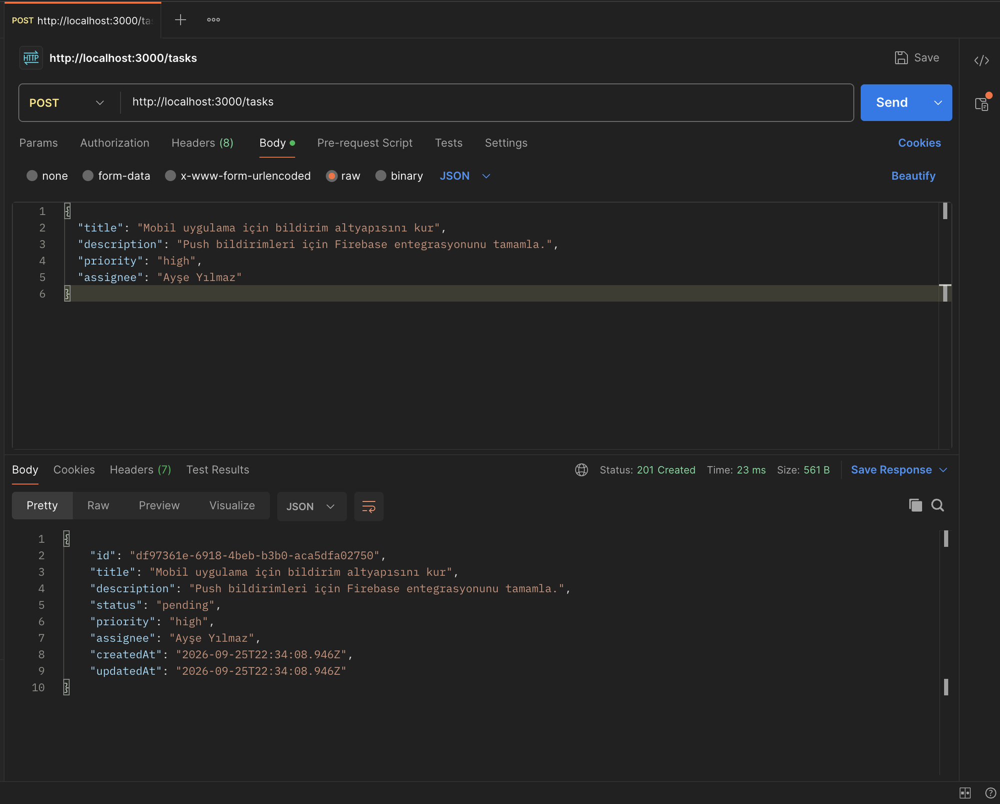
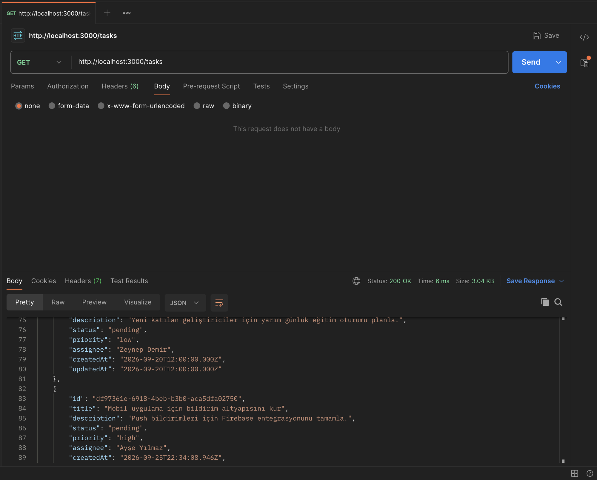
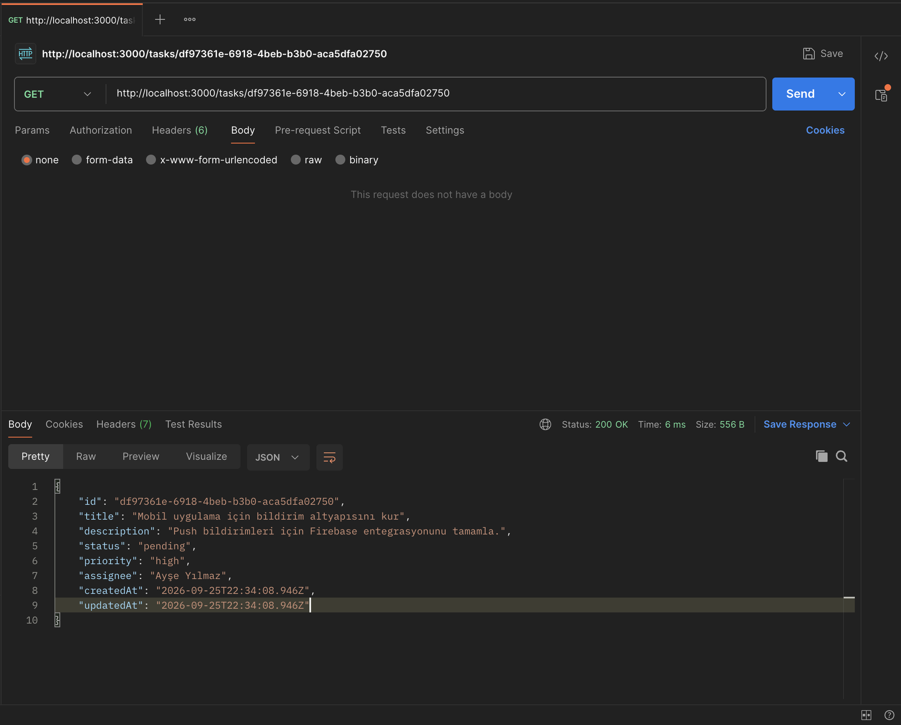
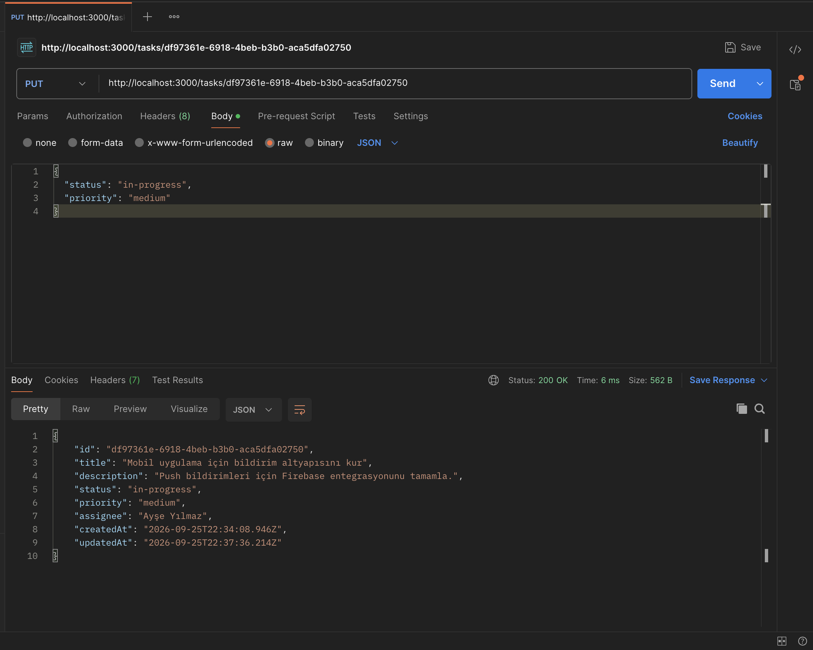
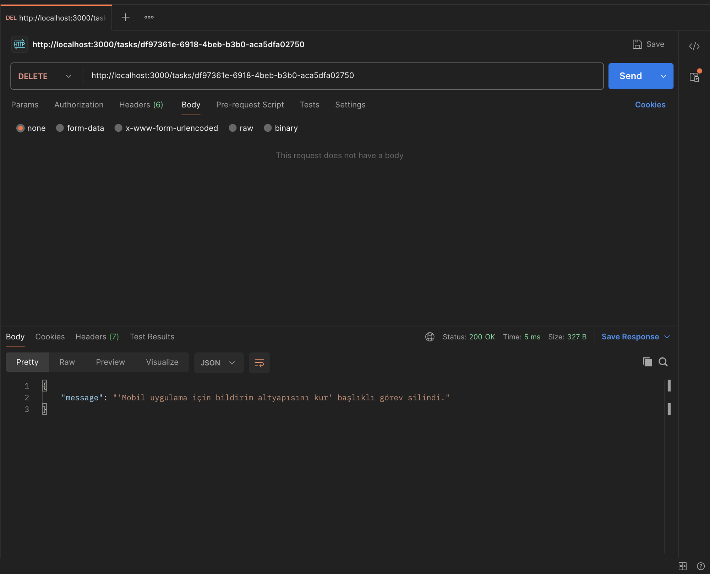
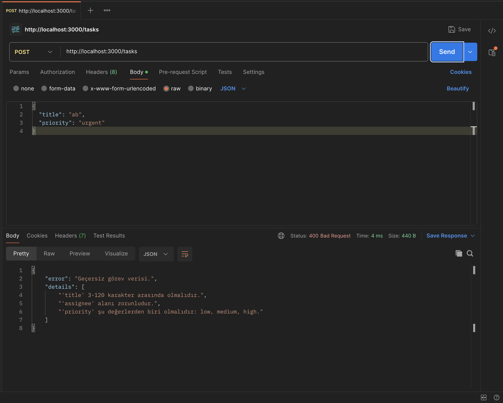
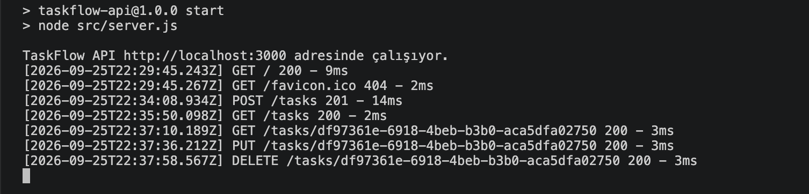

# TaskFlow API — Görev ve Proje Yönetim Sistemi

TaskFlow, bir yazılım şirketinin görevlerini, projelerini ve çalışan sorumluluklarını takip etmesi için geliştirilmiş bir **REST API**'dir. Görev oluşturma, görevleri çalışanlara atama, durum takibi ve önceliklendirme desteklenir.

TNC Group Node.js Backend eğitimi bitirme projesidir. Proje tanıtım dokümanı: [docs/PROJE_TANITIM.md](docs/PROJE_TANITIM.md)

## Özellikler

**Zorunlu**

- ✅ Görev ekleme, listeleme, detay görüntüleme, güncelleme ve silme (CRUD)
- ✅ Express Router ile katmanlı klasör yapısı (routes → controllers → services)
- ✅ Logger middleware: her isteğin method, endpoint ve zaman bilgisi konsola ve `logs/requests.log` dosyasına yazılır
- ✅ Postman koleksiyonu ve test ekran görüntüleri

**⭐ Ekstra**

- ⭐ Doğrulama (validation) middleware'i: `title`, `description`, `priority`, `assignee` alanları kontrol edilir; hatalı veride **400** ve Türkçe hata mesajı döner
- ⭐ Filtreleme: `GET /tasks?status=completed`, `GET /tasks?priority=high` (birlikte kullanılabilir)
- ⭐ Raporlama: tamamlanan görevler, bekleyen görevler ve özet istatistikler

## Teknolojiler

- Node.js (24 LTS), ES Modules
- Express 5
- Veriler JSON dosyasında tutulur (`data/tasks.json`), veritabanı gerekmez
- Postman (API testleri)

## Kurulum ve Çalıştırma

Gereksinim: [Node.js](https://nodejs.org/) 24 veya üzeri.

1. Depoyu klonlayın:
   ```bash
   git clone https://github.com/ilker-ekin/taskflow-api.git
   cd taskflow-api
   ```
2. Bağımlılıkları yükleyin:
   ```bash
   npm install
   ```
3. Sunucuyu başlatın:
   ```bash
   npm start
   ```
4. API `http://localhost:3000` adresinde çalışır. Tarayıcıda açarak kontrol edebilirsiniz.

İlk çalıştırmada `data/tasks.json`, örnek verilerden (`data/tasks.seed.json`) otomatik oluşturulur.

| Komut | Açıklama |
|---|---|
| `npm start` | Sunucuyu başlatır |
| `npm run dev` | Dosya değişikliklerinde sunucuyu otomatik yeniden başlatır |
| `npm run seed` | Verileri örnek verilere sıfırlar |

Farklı port için: `PORT=4000 npm start`

## Veri Modeli

| Alan | Tip | Kural |
|---|---|---|
| `id` | string (UUID) | Sunucu tarafından atanır |
| `title` | string | Zorunlu, 3–120 karakter |
| `description` | string | İsteğe bağlı, en fazla 1000 karakter |
| `status` | `pending` \| `in-progress` \| `completed` | Varsayılan `pending` |
| `priority` | `low` \| `medium` \| `high` | Varsayılan `medium` |
| `assignee` | string | Zorunlu, 2–50 karakter (çalışan adı) |
| `createdAt`, `updatedAt` | ISO tarih | Sunucu tarafından atanır |

## Endpoint'ler

| Method | Endpoint | Açıklama | Başarılı yanıt |
|---|---|---|---|
| POST | `/tasks` | Yeni görev ekler | 201 |
| GET | `/tasks` | Tüm görevleri listeler | 200 |
| GET | `/tasks/:id` | Görev detayını getirir | 200 / 404 |
| PUT | `/tasks/:id` | Görevi günceller | 200 / 404 |
| DELETE | `/tasks/:id` | Görevi siler | 200 / 404 |
| GET | `/tasks?status=...&priority=...` | ⭐ Filtreli listeleme | 200 |
| GET | `/reports/completed` | ⭐ Tamamlanan görevler | 200 |
| GET | `/reports/pending` | ⭐ Bekleyen görevler | 200 |
| GET | `/reports/summary` | ⭐ Durum ve önceliğe göre özet | 200 |

### Örnek istek ve yanıtlar

**Görev ekleme** — `POST /tasks`

```json
{
  "title": "Mobil uygulama için bildirim altyapısını kur",
  "description": "Push bildirimleri için Firebase entegrasyonunu tamamla.",
  "priority": "high",
  "assignee": "Ayşe Yılmaz"
}
```

Yanıt `201 Created`:

```json
{
  "id": "ddfbfe5e-a247-41b5-8d4c-e15bbc5766be",
  "title": "Mobil uygulama için bildirim altyapısını kur",
  "description": "Push bildirimleri için Firebase entegrasyonunu tamamla.",
  "status": "pending",
  "priority": "high",
  "assignee": "Ayşe Yılmaz",
  "createdAt": "2026-09-25T22:24:35.411Z",
  "updatedAt": "2026-09-25T22:24:35.411Z"
}
```

**Görev güncelleme** — `PUT /tasks/:id` (yalnızca değişecek alanlar gönderilir)

```json
{ "status": "completed" }
```

Yanıt `200 OK`: güncellenmiş görev nesnesi.

**Görev silme** — `DELETE /tasks/:id`, yanıt `200 OK`:

```json
{ "message": "'Mobil uygulama için bildirim altyapısını kur' başlıklı görev silindi." }
```

**Özet rapor** — `GET /reports/summary`, yanıt `200 OK`:

```json
{
  "total": 8,
  "byStatus": { "pending": 4, "in-progress": 2, "completed": 2 },
  "byPriority": { "low": 2, "medium": 3, "high": 3 }
}
```

### Hata yanıtları

Tüm hatalar `{ "error": "..." }` biçiminde döner.

| Durum | Örnek |
|---|---|
| 400 — geçersiz veri | `{ "error": "Geçersiz görev verisi.", "details": ["'title' 3-120 karakter arasında olmalıdır.", "'assignee' alanı zorunludur."] }` |
| 400 — bozuk JSON | `{ "error": "İstek gövdesi geçerli bir JSON değil." }` |
| 404 — görev yok | `{ "error": "'abc' kimlikli görev bulunamadı." }` |
| 404 — adres yok | `{ "error": "İstenen adres bulunamadı: GET /nope" }` |
| 500 — sunucu hatası | `{ "error": "Sunucuda beklenmeyen bir hata oluştu." }` |

## Logger Middleware

`src/middlewares/logger.js` her isteği, yanıt gönderildikten sonra **method, endpoint, zaman damgası**, durum kodu ve süre bilgisiyle konsola yazar ve aynı satırı `logs/requests.log` dosyasına ekler (klasör yoksa oluşturulur).

```
[2026-09-25T22:24:35.411Z] POST /tasks 201 - 2ms
[2026-09-25T22:24:35.430Z] GET /tasks/ddfbfe5e-a247-41b5-8d4c-e15bbc5766be 200 - 1ms
[2026-09-25T22:24:35.441Z] PUT /tasks/ddfbfe5e-a247-41b5-8d4c-e15bbc5766be 200 - 1ms
[2026-09-25T22:24:35.452Z] GET /tasks?status=completed&priority=high 200 - 1ms
[2026-09-25T22:24:35.470Z] POST /tasks 400 - 0ms
[2026-09-25T22:24:35.498Z] DELETE /tasks/ddfbfe5e-a247-41b5-8d4c-e15bbc5766be 200 - 1ms
```

## Postman ile Test

1. Sunucuyu `npm start` ile başlatın.
2. Postman'de **Import** → `postman/TaskFlow.postman_collection.json` dosyasını seçin.
3. Koleksiyon değişkeni `baseUrl` = `http://localhost:3000` olarak tanımlıdır.
4. **CRUD** klasöründeki istekleri sırayla çalıştırın. "Görev Ekle" oluşturulan görevin id değerini `taskId` değişkenine kaydeder; sonraki istekler bu değeri kullanır.
5. **Ekstra** klasöründe doğrulama hatası, filtreleme ve rapor istekleri bulunur.

Her istekte durum kodunu kontrol eden testler vardır (Test Results sekmesi). Tüm koleksiyon **Run collection** ile tek seferde çalıştırılabilir.

## Ekran Görüntüleri

| İstek | Ekran görüntüsü |
|---|---|
| Görev Ekle — `POST /tasks` |  |
| Görevleri Listele — `GET /tasks` |  |
| Görev Detayı — `GET /tasks/:id` |  |
| Görev Güncelle — `PUT /tasks/:id` |  |
| Görev Sil — `DELETE /tasks/:id` |  |
| ⭐ Doğrulama hatası — 400 |  |
| Logger konsol çıktısı |  |

## Proje Yapısı

```
taskflow-api/
├── data/
│   └── tasks.seed.json          # Örnek görevler (tasks.json buradan oluşturulur)
├── docs/
│   ├── PROJE_TANITIM.md         # Proje tanıtım dokümanı
│   └── screenshots/             # Postman ekran görüntüleri
├── postman/
│   └── TaskFlow.postman_collection.json
├── scripts/
│   └── seed.js                  # npm run seed
├── src/
│   ├── app.js                   # Express uygulaması: middleware'ler ve route'lar
│   ├── server.js                # Sunucuyu başlatır
│   ├── routes/                  # task.routes.js, report.routes.js
│   ├── controllers/             # task.controller.js, report.controller.js
│   ├── services/                # task.service.js (JSON dosyası okuma/yazma)
│   └── middlewares/             # logger.js, validateTask.js, errorHandler.js, notFound.js
├── package.json
└── README.md
```

## Geliştirici

İlker Ekin Erdoğdu — [@ilker-ekin](https://github.com/ilker-ekin)
